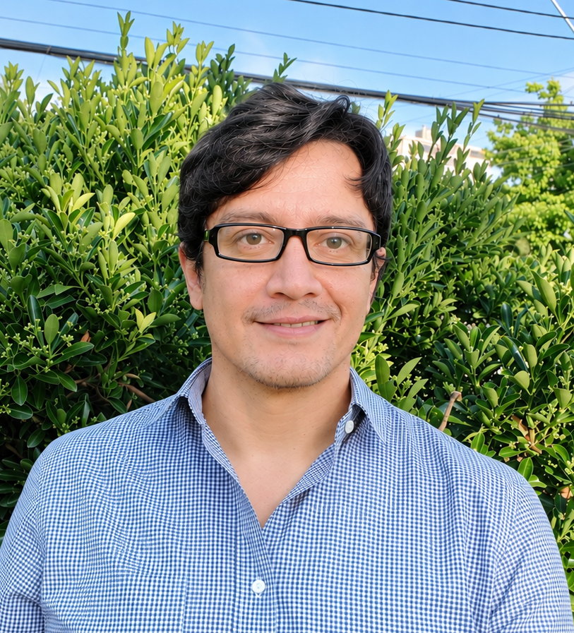
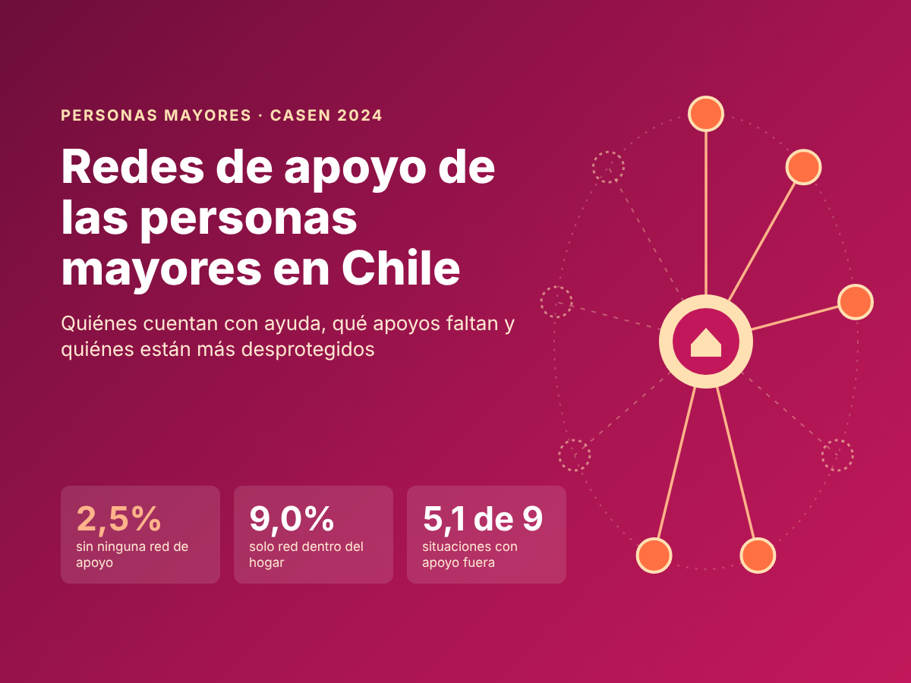
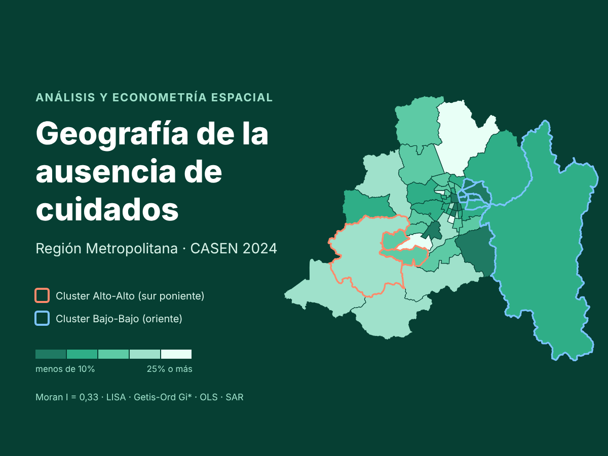
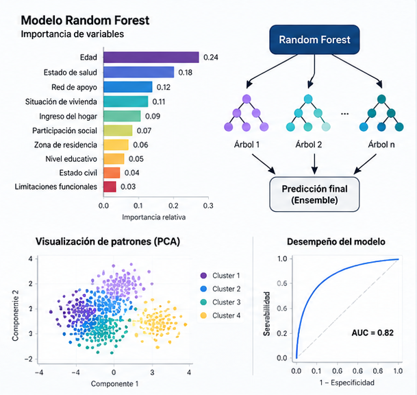
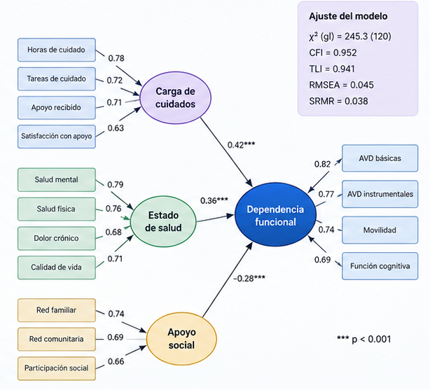
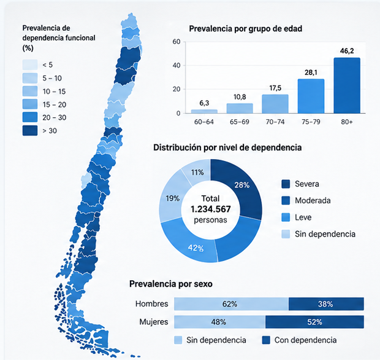
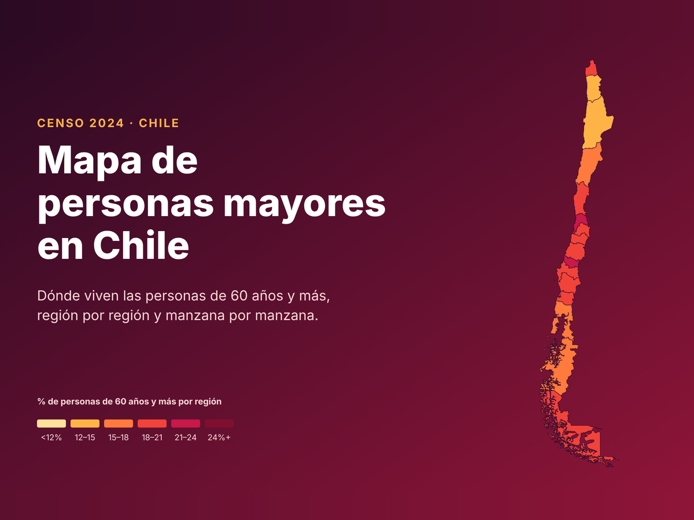

<div class="site-banner">
  
</div>

<style>
.site-banner {
  width: 100%;
  margin: 0 auto 1.75rem auto;
}
.site-banner img {
  display: block;
  width: 100%;
  height: auto;
  max-height: 300px;
  object-fit: cover;
  object-position: center;
  border-radius: 18px;
}
@media (max-width: 700px) {
  .site-banner { margin-bottom: 1.25rem; }
  .site-banner img { max-height: 180px; border-radius: 12px; }
}

/* Celular: el ícono de "Sobre mí" va arriba (sin superponerse) y el texto usa todo el ancho */
@media (max-width: 700px) {
  .home-main .home-section { display: block !important; grid-template-columns: 1fr !important; }
  .home-main .home-image { width: 72px !important; margin: 0 auto 1rem auto !important; }
  .home-main .home-image img { width: 72px !important; height: 72px !important; max-width: 72px !important; }
}
</style>

<div class="home-layout">

<div class="home-sidebar">

{.profile-photo}

# Genaro Marileo

**Sociólogo de la Universidad de Chile**

Investigación social aplicada · análisis de datos · políticas públicas

<div class="profile-links">

[Correo electrónico](mailto:genarouchile@gmail.com)

[CV](cv.html)

[LinkedIn](https://www.linkedin.com/in/genaro-c-marileo-mill%C3%A1n-257b7a55/)

[GitHub](https://github.com/genarouchile)

</div>

</div>


<div class="home-main">

<p class="academic-line">
Investigación aplicada · políticas públicas · personas mayores · cuidados · análisis cuantitativo y territorial
</p>


<div class="home-section">

<div class="home-image">


</div>

<div class="home-content">

## Sobre mí

Soy sociólogo de la [Universidad de Chile](https://uchile.cl/), Magíster y Doctor (c) en Sociología de la [Pontificia Universidad Católica](https://sociologia.uc.cl/) y Doctor en Sociología en la [Universidad Alberto Hurtado](https://www.uahurtado.cl/la-universidad/). Mi trabajo se orienta al análisis y diseño de políticas públicas, el análisis estadístico y el estudio de problemas públicos mediante herramientas cuantitativas y territoriales.

Mi experiencia combina investigación social, construcción de indicadores, análisis estadístico y evaluación de impacto de políticas públicas. He desarrollado proyectos utilizando datos sociales, administrativos y territoriales, con especial interés en vulnerabilidad social, vivienda social, cuidados, personas mayores y desigualdad territorial.

Mi enfoque de trabajo integra el rigor metodológico con una perspectiva aplicada de la investigación social. Me interesa desarrollar herramientas analíticas y producir evidencia empírica que permitan comprender fenómenos complejos, identificar brechas y contribuir a una mejor toma de decisiones en el ámbito de las políticas públicas.

</div>

</div>


```{=html}
<div class="home-projects">
  <h2 class="home-projects-title">Proyectos destacados</h2>
<div class="project-tiles">
    <a class="project-tile" href="portafolio/redes-apoyo-personas-mayores/">
      
      <span class="tile-title">Redes de apoyo de las personas mayores en Chile</span>
      <span class="tile-sub">Modelo IRT · Modelo clases latentes · CASEN 2024</span>
    </a>
    <a class="project-tile" href="proyectos/ausencia-cuidados-rm/">
      
      <span class="tile-title">Econometría Espacial: Ausencia de los Cuidados en RM</span>
      <span class="tile-sub">Moran · LISA · Getis-Ord Gi* · Modelo SAR · CASEN 2024</span>
    </a>
    <a class="project-tile" href="portafolio/soledad-machine-learning/">
      
      <span class="tile-title">Machine Learning: Soledad no deseada en personas mayores</span>
      <span class="tile-sub">Árbol de decisión y Random Forest</span>
    </a>
    <a class="project-tile" href="portafolio/proyecto-1/">
      
      <span class="tile-title">Ecuaciones estructurales: personas mayores cuidadoras</span>
      <span class="tile-sub">Modelo SEM mediación · Calidad de Vida en la Vejez</span>
    </a>
    <a class="project-tile" href="dependencia-funcional/">
      
      <span class="tile-title">Dependencia funcional en personas mayores en Chile</span>
      <span class="tile-sub">Análisis estadístico · ENDIDE 2022</span>
    </a>
    <a class="project-tile" href="proyectos/mapa-personas-mayores-censo-2024/">
      
      <span class="tile-title">Mapa de Personas Mayores en Chile (Censo 2024)</span>
      <span class="tile-sub">Mapas interactivos · regiones, comunas y manzanas</span>
    </a>
  </div>


</div>
```

</div>

</div>
