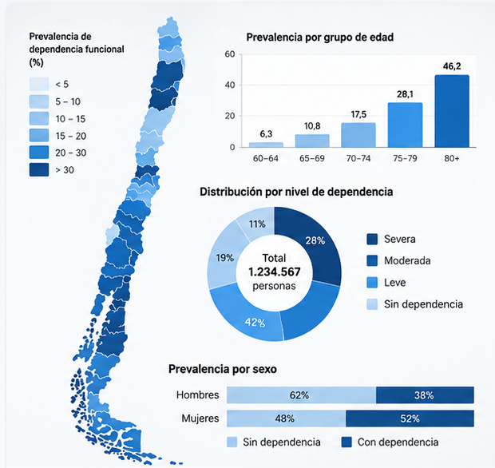
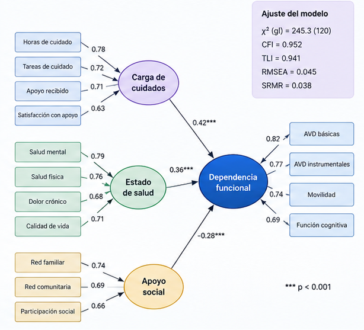
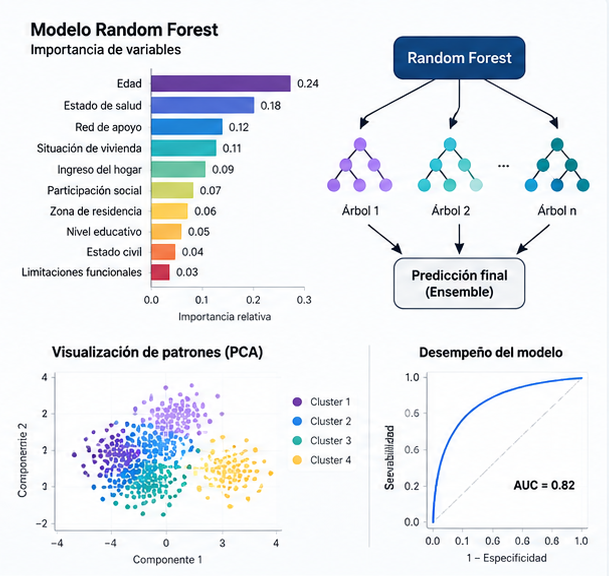
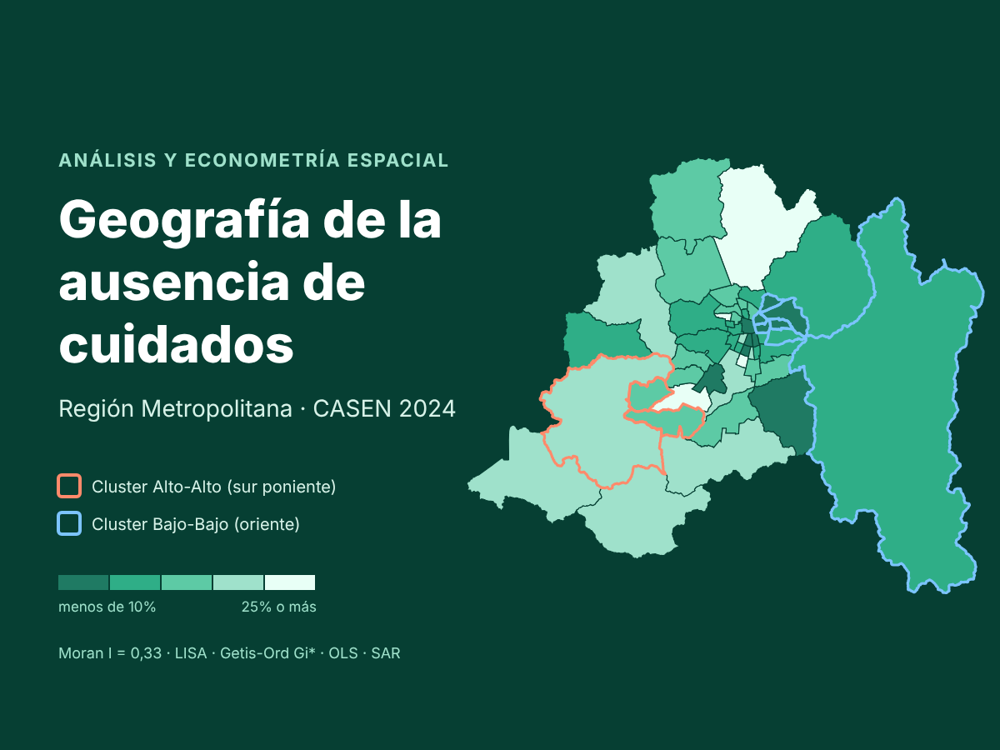
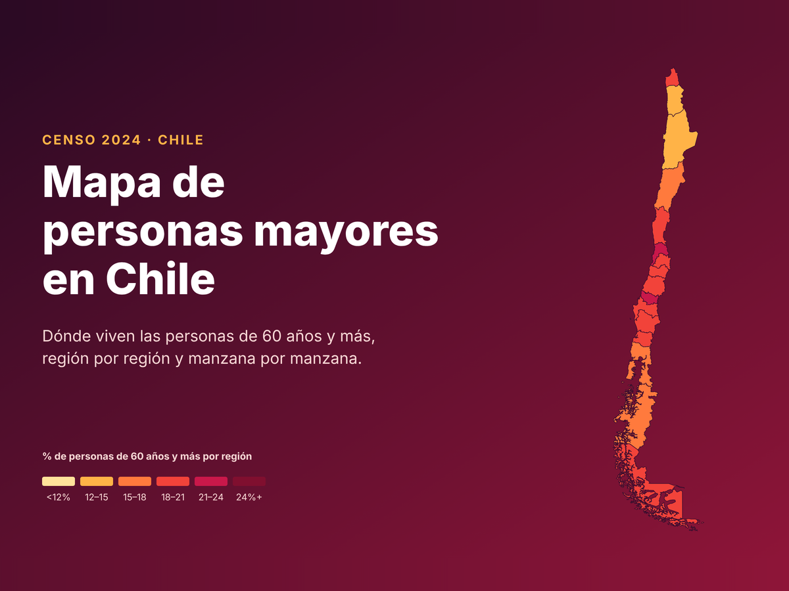

<div class="home-layout">

<div class="home-sidebar">

{.profile-photo}

# Genaro Marileo

**Sociólogo de la Universidad de Chile**

Investigación social aplicada · análisis de datos · políticas públicas · análisis territorial

<div class="profile-links">

[Correo electrónico](mailto:genarouchile@gmail.com)

[CV](cv.html)

[LinkedIn](https://www.linkedin.com/in/genaro-c-marileo-mill%C3%A1n-257b7a55/)

[GitHub](https://github.com/genarouchile)

</div>

</div>


<div class="home-main">

<p class="research-line">
Investigación social aplicada · análisis cuantitativo · políticas públicas · análisis territorial
</p>

<p class="academic-line">
Sociólogo · Magíster en Sociología · Doctor en Sociología
</p>


<div class="home-section">

<div class="home-image">


</div>

<div class="home-content">

## Sobre mí

Soy sociólogo de la [Universidad de Chile](https://facso.uchile.cl), Magíster en Sociología de la [Pontificia Universidad Católica](https://sociologia.uc.cl/) y Doctor en Sociología en la [Universidad Alberto Hurtado](https://csociales.uahurtado.cl/departamentos/departamento-de-sociologia/). Mi trabajo se orienta al análisis y diseño de políticas públicas, el análisis estadístico y el estudio de problemas públicos mediante herramientas cuantitativas y territoriales.

Mi experiencia combina investigación social, construcción de indicadores, análisis estadístico, evaluación de políticas públicas y análisis espacial. He desarrollado proyectos utilizando datos sociales, administrativos y territoriales, con especial interés en vulnerabilidad social, cuidados, personas mayores y desigualdad territorial.

Actualmente desarrollo investigación aplicada vinculada al análisis territorial y a la generación de evidencia para apoyar la toma de decisiones en políticas públicas.

</div>

</div>


```{=html}
<div class="home-projects">
  <h2 class="home-projects-title">Proyectos destacados</h2>
  <div class="project-tiles">
    <a class="project-tile" href="dependencia-funcional/">
      
      <span class="tile-title">Dependencia funcional en personas mayores en Chile</span>
      <span class="tile-sub">Análisis estadístico · ENDIDE 2022</span>
    </a>
    <a class="project-tile" href="portafolio/proyecto-1/">
      
      <span class="tile-title">Ecuaciones estructurales: personas mayores cuidadoras</span>
      <span class="tile-sub">SEM · ENDIDE y Calidad de Vida en la Vejez</span>
    </a>
    <a class="project-tile" href="portafolio/soledad-machine-learning/">
      
      <span class="tile-title">Machine Learning: Soledad no deseada en personas mayores</span>
      <span class="tile-sub">Árbol de decisión y Random Forest</span>
    </a>

    <a class="project-tile" href="proyectos/ausencia-cuidados-rm/">
      
      <span class="tile-title">Econometría Espacial: Ausencia de los Cuidados en RM</span>
      <span class="tile-sub">Moran · LISA · Getis-Ord Gi* · SAR · CASEN 2024</span>
    </a>
    <a class="project-tile" href="proyectos/mapa-personas-mayores-censo-2024/">
      
      <span class="tile-title">Mapa de Personas Mayores en Chile (Censo 2024)</span>
      <span class="tile-sub">Mapas interactivos · regiones, comunas y manzanas</span>
    </a>

  </div>
</div>
```

</div>

</div>
